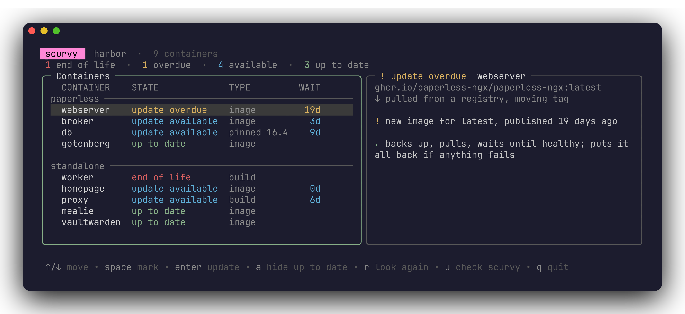

# 🍋 scurvy

scurvy shows which docker containers on a server are out of date, and updates them safely with Enter: it keeps a backup, waits until the containers are healthy, and puts everything back if anything fails. One program, no config, no daemon.



## Install

```sh
curl -fsSL https://github.com/chriopter/scurvy/releases/latest/download/install.sh | sudo bash
scurvy
```

## What it checks

scurvy finds the running containers and reads their compose files and Dockerfiles. For each it asks the registry what its tag points to now, looks for newer versions of a fixed one, and asks [endoflife.date](https://endoflife.date) whether its base still gets fixes. Nothing is pulled to check.

## What it shows

| state | means |
|---|---|
| 🟢 up to date | nothing newer |
| 🔵 update available | a new image or version is there |
| 🟡 update overdue | waiting too long: 14 days for an image, 90 for a version, 30 for a build |
| 🔴 end of life | the base (alpine, debian, python, node, …) gets no fixes any more |
| ⚪ not checked | the registry did not answer, or the image is private |

Containers of one compose stack stand together. The right panel tells everything about the picked one.

## What Enter does

<kbd>Enter</kbd> updates the picked container, or on a stack's line all of its; <kbd>space</kbd> marks several to update at once; <kbd>R</kbd> rebuilds from scratch, without the build cache.

| type | image comes from | Enter |
|---|---|---|
| image | a registry, moving tag (`:latest`) | pulls, restarts |
| pinned 16.4 | a registry, fixed version (`:16.4`) | writes `16.6` into the compose file, pulls, restarts |
| build | a local Dockerfile | raises a fixed `FROM`, rebuilds, restarts |
| build | a local Dockerfile in a git clone | `git pull`, rebuilds, restarts |
| pinned digest | a registry, fixed digest (`@sha256:…`) | nothing |
| aio | Nextcloud All-in-One | asks its mastercontainer to update all of AIO, with AIO's backup if set up |
| external | another tool, or `docker run` | nothing |

A stack with its own `docker-update.sh` gets that script run instead. Before every update the running image is kept as `<image>:bak-<time>`; after it, scurvy waits until the containers are healthy. [Details](docs/how.md)

## Command line

```sh
scurvy -n               # the screen, but Enter only shows what it would change
scurvy list             # the update state of every container, as text
scurvy list --influx    # the same as InfluxDB lines, for Telegraf
scurvy fix web          # update one container (or stack/service), or a stack
scurvy update           # update scurvy itself
```

For Grafana, let Telegraf ask every few hours; each run asks the registries:

```toml
[[inputs.exec]]
  commands = ["sudo -n /usr/local/bin/scurvy list --influx"]
  interval = "6h"
  timeout = "120s"
  data_format = "influx"
```

Each container becomes a point `scurvy,stack=…,container=…,type=…` with `state`, `level` (0 up to date, 1 available, 2 overdue, 3 end of life, -1 not checked) and `waiting_days`.

## Development

```sh
bin/setup    # build and install from this checkout
bin/dev      # run against this machine's containers, dry run
bin/update   # pull and install again
```

Releases are signed with Ed25519; scurvy and the installer refuse anything else. See [AGENTS.md](AGENTS.md).
